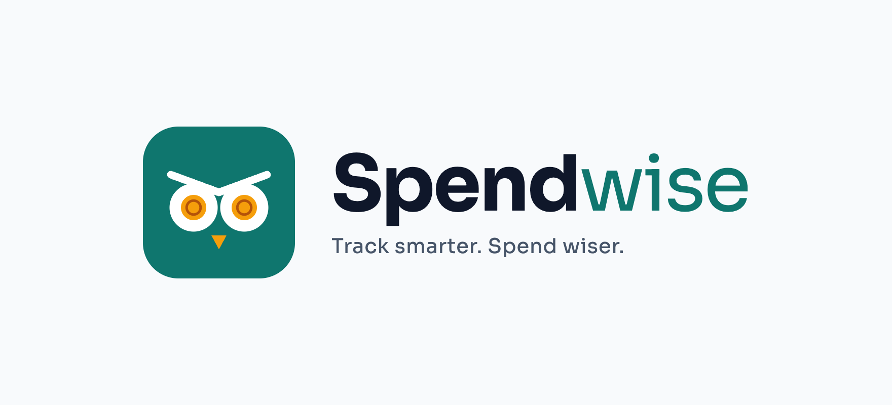

<p align="center">
  
</p>

# Spendwise: Student Finance Tracker

**Live demo (GitHub Pages):** https://shyaka-alex.github.io/finance-tracker/
**Demo video (unlisted):** https://youtu.be/bAOfuL--lT0
**Tests:** https://shyaka-alex.github.io/finance-tracker/tests.html

Spendwise is an accessible, responsive student finance tracker for students in Rwanda, built with **plain HTML, CSS and JavaScript only** (no frameworks or libraries). All money is in **Rwandan francs (RWF)** by default. You can log transactions, find them with live **regular-expression search**, watch the last seven days of spending, and stay under a monthly budget cap that is announced to screen reader users.

- **Theme chosen:** Student Finance Tracker
- **Author:** Shyaka Alex · [GitHub](https://github.com/shyaka-alex) · b.shyaka@alustudent.com

---

## Features

| Area | What it does |
|---|---|
| Home | Landing page with a hero, feature cards, About (with a founder profile) and a Contact form. Mockup images live in `assets/img/` |
| About | Its own page: what Spendwise is, plus a founder profile |
| Contact | Its own page: contact details and a message form (email checked with a regex, then opened in your email app) |
| Dashboard | Greeting with today’s date, total transactions, total spent, top category, last-7-days total, a “This Week” CSS bar chart (with a screen-reader text alternative), a monthly budget, a spending-by-category breakdown, and the add form beside the transactions |
| Budget cap | Monthly cap with a progress bar, remaining amount or overage, days left and a daily allowance. Under the cap it is announced politely; over the cap it is announced assertively |
| Transactions | Table on tablet/desktop, cards on mobile. Live regex search (always case-insensitive), `<mark>` highlighting, sorting by date, description (A↕Z) and amount (↑↓) using a dropdown or the column headers |
| Inline edit & delete | Edit any row in place (same validation as the form, updates `updatedAt`). Delete asks for confirmation in an accessible `<dialog>` |
| Add form | Beside the transactions on wide screens. Four regex rules with inline errors as you type, plus a duplicate-word warning (back-reference). The “Add transaction” button jumps to it and focuses the first field |
| Settings | Base currency RWF plus USD and EUR with manual rates (RWF per 1 unit, e.g. 1 USD = 1450 RWF), display currency, monthly cap, editable categories, light/dark theme, and a danger zone for clearing data. Saves show a toast that is also read by screen readers |
| Data | Auto-save to `localStorage`, JSON import with full validation, JSON and CSV export, load sample data, clear all data |
| Stretch goals | Light/dark theme (saved), CSV export (escaped), reduced-motion support |

## Run it locally

ES modules need a web server (opening `index.html` straight from disk will not work).

```bash
git clone https://github.com/shyaka-alex/finance-tracker.git
cd finance-tracker
python3 -m http.server 8000
# open http://localhost:8000
```

Click **Load sample data** (the empty transactions list on the Dashboard, or Settings → Your Data) to load the 14 records from `seed.json`.

## Run the tests

Open [`tests.html`](tests.html) through the same server (`http://localhost:8000/tests.html`) or on GitHub Pages. It runs 100+ assertions covering every regex rule, the safe regex compiler, highlighting, sorting, stats/cap logic, JSON import validation, CSV escaping and settings recovery. The summary at the top shows how many passed; failures show the actual and expected values.

---

## Regex catalog

| # | Rule | Pattern | Valid examples | Rejected examples |
|---|---|---|---|---|
| 1 | Description: no leading/trailing spaces | `/^\S(?:.*\S)?$/` | `Lunch at cafeteria`, `A` | ` Lunch`, `Lunch ` |
| 1b | Description: no double spaces | `/ {2,}/` (must **not** match) | `Bus pass` | `Bus  pass` |
| 2 | Amount | `/^(0\|[1-9]\d*)(\.\d{1,2})?$/` | `0`, `500`, `2500`, `2500.50` | `0500`, `-500`, `2,500`, `1.234`, `1e3` |
| 3 | Date (YYYY-MM-DD) | `/^\d{4}-(0[1-9]\|1[0-2])-(0[1-9]\|[12]\d\|3[01])$/` + real-calendar check | `2026-10-12`, `2024-02-29` | `2026-13-01`, `2025-02-29`, `26-10-12` |
| 4 | Category | `/^[A-Za-z]+(?:[ -][A-Za-z]+)*$/` | `Food`, `Eating Out`, `Self-care` | `Food1`, `-Food`, `Eating  Out` |
| 5 | **Advanced, back-reference**: duplicate word | `/\b(\w+)\s+\1\b/i` | warns on `Coffee coffee with Amina`, `the the` | no warning for `the theme` |
| 6 | **Advanced, lookahead**: positive exchange rate | `/^(?=.*[1-9])(0\|[1-9]\d*)(\.\d{1,6})?$/` | `1450`, `1580.25`, `0.000001` | `0`, `0.000`, `-1` |
| 7 | Currency code | `/^[A-Z]{3}$/` | `RWF`, `USD` | `rwf`, `RW` |
| 8 | Contact email | `/^[^\s@]+@[^\s@.]+(?:\.[^\s@.]+)*\.[A-Za-z]{2,}$/` | `b.shyaka@alustudent.com` | `alex@alu`, `alex @alu.edu` |

### Search examples to try (Transactions page)

| Pattern | Finds |
|---|---|
| `(coffee\|tea)` | Beverage purchases (case-insensitive by default) |
| `\d{2},\d{3}` | Spends of RWF 10,000 or more, e.g. `RWF 35,000` |
| `\b(\w+)\s+\1\b` | Descriptions with a repeated word (`Coffee coffee`) |
| `^2026-10` | Everything dated October 2026 |
| `(moto\|bus\|tap&go)` | Transport costs around Kigali |
| `[abc` | Invalid pattern: shows an error and does not crash |

Search runs on what you see (date, description, category and the formatted amount). Patterns are compiled inside `try/catch` (`compileRegex` in `scripts/search.js`). Text is HTML-escaped before `<mark>` tags are added, so data like `Printing <lecture notes>` can never inject markup.

---

## Keyboard map

| Key | Where | Action |
|---|---|---|
| `Tab` / `Shift+Tab` | Everywhere | Move between links, buttons and fields in visual order |
| `Tab` (first press) | Page load | Reveals the **Skip to main content** link |
| `Enter` | Navigation links | Switch page or jump to a section; focus moves to its heading |
| `Enter` / `Escape` | Menu button (mobile) | Open the menu / close it and return focus to the button |
| `Enter` | Add form | Save the transaction (focus jumps to the first invalid field if any) |
| `Space` | Checkboxes | Toggle the dark theme |
| `Enter` | Sort header buttons | Sort by that column; press again to reverse |
| `Enter` | Inline edit field | Save the row |
| `Escape` | Inline edit field | Cancel editing and return focus to the row's Edit button |
| `Escape` | Confirm dialog | Cancel (focus returns to the button that opened it) |

## Accessibility notes

- **Landmarks and headings:** `header`, `nav`, `main`, five views (Home, About, Contact, Dashboard, Settings) as `section`s, and `footer`; one `h1`, an `h2` per view, `h3` for each section or card.
- **Labels:** every input has a visible `<label for>`; settings are grouped in `fieldset`/`legend`.
- **Errors:** inline messages are linked with `aria-describedby`, and invalid fields get `aria-invalid="true"`.
- **Live regions:** `role="status"` (polite) and `role="alert"` (assertive) regions announce saves, deletes, imports and the budget cap. Messages are appended, not replaced, so quick back-to-back messages are both read. The result count under the search box is also a status region.
- **Focus:** a thick `3px` outline on every focusable element (`:focus-visible`), never removed. Focus is managed after deleting (moves to the next row), editing and closing dialogs.
- **Mobile table:** rows become cards with CSS, and explicit `role="table/row/cell"` keeps the table semantics when `display` changes.
- **Colour:** text pairs meet WCAG AA (for example deep green `#0F4D3A` on white ≈ 9.8:1, muted text `#4F5B55` ≈ 6.5:1). Orange buttons use dark text. Budget state is shown by wording and an icon, not colour alone.
- **Motion:** section fade-in, bar growth, progress-bar fill and button lift are all switched off under `prefers-reduced-motion`.

## Data model

```json
{
  "id": "txn_0001",
  "description": "Lunch at cafeteria",
  "amount": 2500,
  "category": "Food",
  "date": "2026-10-12",
  "createdAt": "2026-10-12T11:42:05.000Z",
  "updatedAt": "2026-10-12T11:42:05.000Z"
}
```

Amounts are stored in the base currency (Rwandan francs by default). `localStorage` keys: `spendwise:records` (array of records) and `spendwise:settings` (currencies, cap, categories, theme). Damaged stored records are skipped and announced on startup instead of crashing the app.

`seed.json` has 14 records with edge cases: a leap day (`2024-02-29`), year boundaries, a `0` amount, a large amount (`RWF 1,250,000` tuition), a 100+ character description, accented text (`Café au lait`), HTML-like text (`<lecture notes>`) and a duplicate word (`Coffee coffee`).

## Project structure

```
index.html            single page with all sections
tests.html            browser test runner
seed.json             sample data (14 records)
styles/main.css       mobile-first styles, light + dark themes
scripts/
  main.js             entry point, wires modules together
  state.js            in-memory state, add/edit/delete, change events
  storage.js          localStorage, import validation, JSON/CSV export
  validators.js       every regex rule
  search.js           safe regex compiler, <mark> highlight, sorting
  stats.js            dashboard numbers (pure functions)
  format.js           currency conversion and dates
  ui.js               live announcements, toast, hash navigation, mobile menu, confirm dialog
  form.js             add-transaction form
  records.js          table/cards, search, inline edit, delete
  contact.js          contact form validation and mailto hand-off
  dashboard.js        stat cards, categories, budget cap
  settings.js         currencies, cap, categories, theme, data tools
assets/               logo mark, favicon, brand images, img/ mockups for the home page
docs/design.md        M1 spec: data model, wireframes, a11y plan
```

## Breakpoints

| Width | Layout |
|---|---|
| ~360px (base) | Single column, menu button for navigation, transactions shown as cards with sort chips |
| ≥ 640px | 2-column stat cards and feature cards |
| ≥ 768px | Real transactions table, 2-column dashboard cards, two-column add form |
| ≥ 1024px | Full navigation bar, two-column home sections, 4 stat cards, 3 dashboard cards in a row |
| ≥ 1280px | Transactions and the add form side by side (the form stays in view while scrolling) |

## Milestones

| Milestone | Commit |
|---|---|
| M1 Spec & wireframes | `docs/design.md`, `seed.json` |
| M2 Semantic HTML & base CSS | `feat(m2)` |
| M3 Forms & regex validation + tests | `feat(m3)` |
| M4 Render, sort, regex search | `feat(m4)` |
| M5 Stats & cap | `feat(m5)` |
| M6 Persistence, import/export, settings | `feat(m6)` |
| M7 Polish, a11y audit, README | `docs(m7)` |

---

_Documentation drafted with AI assistance, as permitted by the assignment._
